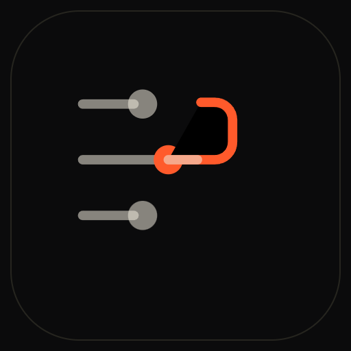
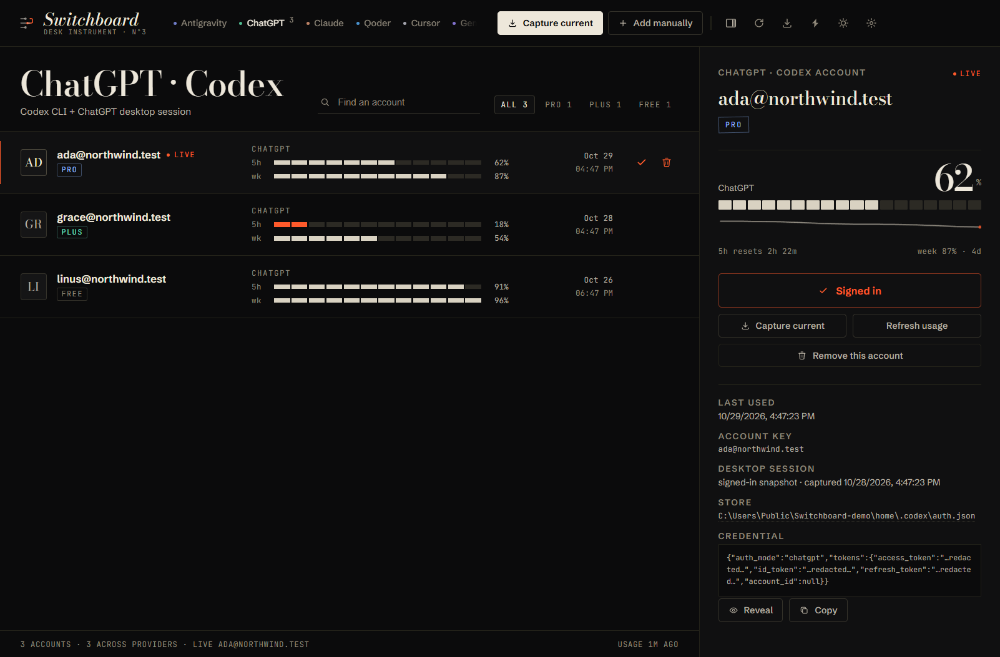
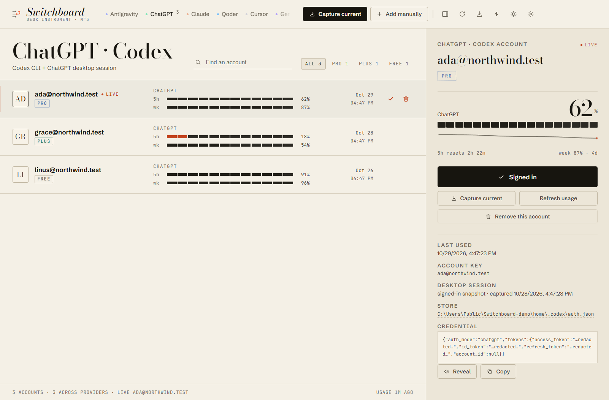
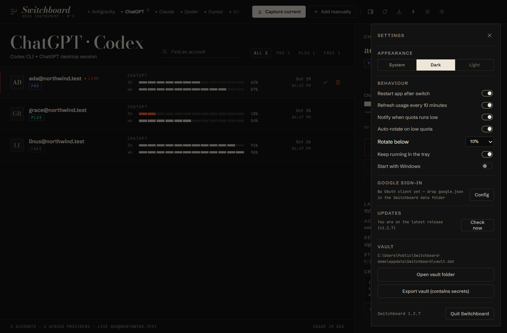
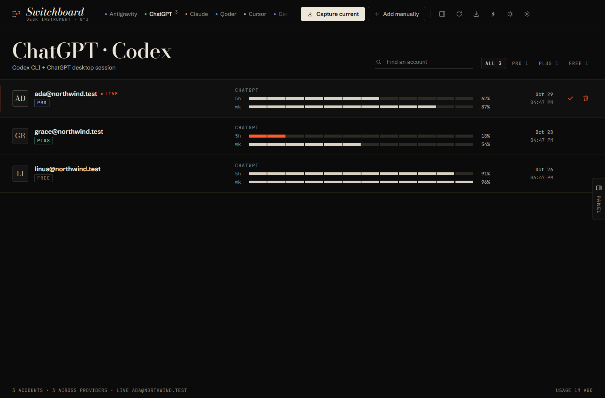
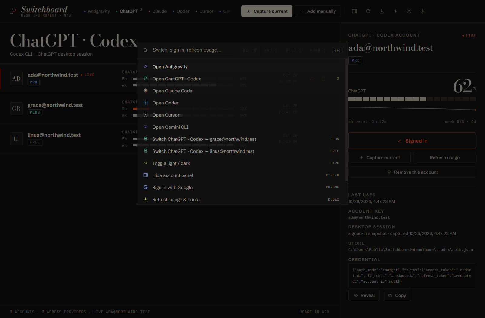

<div align="center">



# Switchboard

### Every AI coding account. One switchboard.

Capture the live sign-in of every coding agent on your PC, watch the quota burn down, and
move to the next account in one verified click — no re-login, no browser dance, no guesswork.

[](https://github.com/KHHH2312/switchboard/releases/latest)
[](https://github.com/KHHH2312/switchboard/releases)
[](#requirements)
[](LICENSE)



</div>

> **New in 1.2** — collapsible account panel (`Ctrl+B`) · explicit remove-account with
> confirmation · signed-in ChatGPT desktop snapshots · auto-rotate when quota runs low ·
> tray + `Ctrl+Alt+S` · usage-history sparklines · SHA-256-verified one-click updates.
> [Full changelog →](CHANGELOG.md)

---

## Why people keep it pinned

**It rotates for you.** Set a floor — 10% by default — and Switchboard switches to the account
with the most headroom before the agent stalls, then restarts the client. Runs from the tray
with Windows notifications; `Ctrl+Alt+S` summons it anywhere.

**Your quota is a countdown, not a mystery.** Five-hour and weekly windows for every model
group, straight from the vendor's own API, with reset timers — so you switch *before* the
agent stalls, not after.

**Switching is verified, not hoped for.** Every write is read back and the account identity
compared. If verification fails you get an error, not a silent half-switch. Auto-restart
relaunches the client on the new account; Qoder and Cursor are closed first because they
cache auth in memory.

**Sign in with the Chrome you already use.** The Google flow runs in your system browser with
PKCE and a loopback listener — the account already signed in there is one click away.

**One table for six clients.** Antigravity, ChatGPT/Codex, Claude Code, Qoder, Cursor and
Gemini CLI. Plans (PRO / ULTRA / PLUS / MAX / FREE), 5-hour usage history sparklines, key
search, keyboard-first (`Ctrl+K`), light & dark themes, and a DPAPI-sealed vault. No telemetry.

## Features

| | |
|---|---|
| **Auto-rotate** | When the live account crosses your quota floor, Switchboard moves to the healthiest account and restarts the client — with a notification. |
| **Tray + hotkey** | Keep it in the tray, start with Windows, summon with `Ctrl+Alt+S`; auto-rotate keeps working while the window is closed. |
| **Notifications** | Windows toasts for low quota (30-minute dedupe) and for every automatic rotation. |
| **Verified switching** | Credential written, read back, identity-checked, app restarted. Failed switches are reported as failures. |
| **Remove accounts** | Trash on any row, or “Remove this account” in the inspector, behind a confirmation dialog. Deletes the vault entry, captured desktop session and stored profile. |
| **Live usage** | Google Cloud Code quota, OpenAI `wham/usage`, Anthropic OAuth usage, Cursor dashboard — 5-hour + weekly windows with reset times and a usage trend sparkline. |
| **Plan aware** | PRO / ULTRA / PLUS / MAX / FREE badges; filters that only show plans you actually have. |
| **Browser sign-in** | Google OAuth with PKCE in Chrome/Edge; accounts land in the vault with quota ready. |
| **ChatGPT desktop session** | Capture stores the desktop app's own profile beside the Codex account; switching restores it and reopens the app signed in. |
| **Antigravity Tools import** | Bring existing accounts in from `~/.antigravity_tools` with one click. |
| **One-click updates** | In-app check, SHA-256 verified download, self-install and relaunch. |
| **Backups** | Export the vault to a JSON file when you move machines. |
| **Private by design** | Vault sealed with Windows DPAPI; renderer sandboxed; navigation denied; IPC frame-gated; clipboard auto-wipes copied credentials; no telemetry. |
| **Instrument-panel UI** | Bodoni Moda + Schibsted Grotesk + JetBrains Mono, segmented LED meters, light/dark/system themes, `prefers-reduced-motion` respected. |
| **Collapsible panel** | `Ctrl+B` or the top-bar panel button hides the inspector so the ledger uses the full window; a right-edge tab brings it back. |

## Requirements

- Windows 10 or 11, x64
- The client you want to manage (Antigravity, Codex, Claude Code, Qoder, Cursor, Gemini CLI)
- Google sign-in (optional) needs your own OAuth desktop client — this project ships none:
  see [Google sign-in setup](#google-sign-in-setup)

## Install

1. Download the latest **Switchboard-x.y.z-win32-x64.zip** from
   [Releases](https://github.com/KHHH2312/switchboard/releases/latest).
2. Verify it against `SHA256SUMS.txt` attached to the same release:
   ```powershell
   Get-FileHash .\Switchboard-*-win32-x64.zip -Algorithm SHA256
   ```
3. Unzip anywhere and run **Switchboard.exe** (no installer, no admin rights).
4. Switchboard checks for updates on launch; **Settings → Updates** can download, verify and
   install a new release in place.

> Builds are portable and **code-signed with a self-signed development certificate**
> (`Switchboard-signing.cer` ships in the archive). Windows will still show SmartScreen's
> "unknown publisher" until an OV/EV certificate is used — the SHA-256 checksum remains the
> trust anchor.

## Using it

1. Pick a client in the top bar.
2. **Sign in with Google** (Antigravity) or **Capture current** to snapshot what the client is
   signed into right now.
3. Sign into the other account in that client, capture again.
4. Press the switch — the app writes, verifies, restarts the client if you left auto-restart on.
5. Leave **auto-rotate** on in Settings and Switchboard will move you to the healthiest account
   before the quota floor hits — the window can be closed, it lives in the tray.
6. `Ctrl+K` for the command palette; `1`–`6` jumps between clients; `Ctrl+B` hides the
   account panel; `Ctrl+Alt+S` summons the window; the sun icon flips theme.

<div align="center">




</div>

## Supported clients

| Client | Credential store | Usage |
|---|---|---|
| Antigravity | Windows Credential Manager `gemini:antigravity` (+ CLI token mirror) | Google Cloud Code quota |
| ChatGPT · Codex | `%USERPROFILE%\.codex\auth.json` | `chatgpt.com/backend-api/wham/usage` |
| Claude Code | `~/.claude/.credentials.json` + `~/.claude.json` | Anthropic OAuth usage |
| Qoder | `%APPDATA%\com.qoder.app.stable\auth.v1.dat` | — |
| Cursor | `%APPDATA%\Cursor\User\globalStorage\state.vscdb` | Cursor dashboard service |
| Gemini CLI | `~/.gemini/oauth_creds.json` + `google_accounts.json` | — |

## Google sign-in setup

This distribution repository ships **no OAuth credentials**. To enable the Google button,
create a *Desktop app* OAuth client in the
[Google Cloud Console](https://console.cloud.google.com/apis/credentials), then drop:

```json
{ "client_id": "YOUR_ID.apps.googleusercontent.com", "client_secret": "YOUR_SECRET" }
```

into `%APPDATA%\Switchboard\google.json` (create the folder if needed) and restart.
Scopes requested: `openid`, `cloud-platform`, `userinfo.email`, `userinfo.profile`, `cclog`,
`experimentsandconfigs` — the same set Antigravity itself uses.

## Security

- Credentials never leave your machine except to the vendor whose quota/token is being read:
  Google, OpenAI, Anthropic, Cursor. **No telemetry.**
- Vault: `%APPDATA%\Switchboard\vault.dat`, sealed with Windows DPAPI (current user).
- The UI runs in a sandboxed renderer; navigation and window-open are denied; IPC rejects any
  frame that isn't the app's own document; file-opening is restricted to registered credential
  stores. The launcher disables Electron's Node runtime entry points (`RunAsNode`,
  `NODE_OPTIONS`, `--inspect` arguments) before signing.
- Update checks are the only call outside those vendors: `api.github.com` returns the latest
  release tag; no user data is sent. Installs only proceed after the downloaded archive matches
  the SHA-256 in the release's sums file.
- Found a flaw? Please use the private channel in [SECURITY.md](SECURITY.md), not a public issue.

## FAQ

**Does it store my passwords?** No — it stores the same OAuth/refresh tokens the clients
already keep on disk, encrypted with your Windows user key.

**What happens if a switch fails?** You get an explicit error. Nothing is reported as switched
until the credential reads back with the expected identity.

**Does it work if the client is running?** Yes for most; Qoder and Cursor are closed and
relaunched around a switch because they rewrite auth on exit. Capture for ChatGPT/Codex
briefly closes the desktop app to snapshot its session consistently, then reopens it.

**Does switching also log the ChatGPT desktop app in?** Yes — once you have signed the desktop
app into that account and captured it (Capture briefly closes and reopens the app). Capture now
reports whether the snapshot contains a session ("signed-in snapshot"); if it says signed-out,
sign the app in first. Switching restores the active profile and relaunches the app; the Codex
CLI account in `~/.codex/auth.json` moves in the same action.

**Does it need to stay open?** No — keep it in the tray (on by default). Auto-rotate and the
low-quota notifications keep working with the window closed; `Ctrl+Alt+S` brings it back.

**Which Windows versions?** 10 and 11, x64. ARM is not built yet.

**Is it open source?** This repository distributes the application and its documentation; it
does not host the application source.

**What if I hit my quota mid-task?** With auto-rotate on, Switchboard switches accounts for you
and restarts the client; you get a Windows notification either way.

## Changelog

See [CHANGELOG.md](CHANGELOG.md).

## License

MIT — see [LICENSE](LICENSE). Third-party assets in [THIRD-PARTY.md](THIRD-PARTY.md).
"Antigravity", "ChatGPT", "Claude", "Cursor", "Qoder" and "Gemini" are trademarks of their
respective owners; this project is not affiliated with them.
